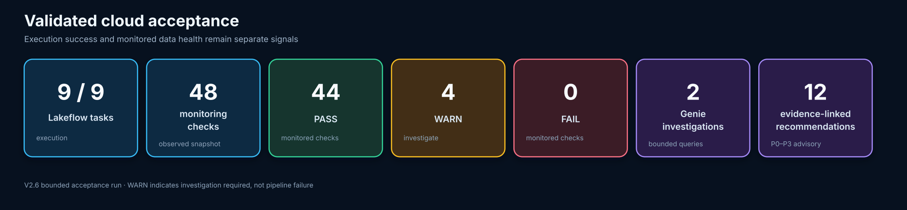
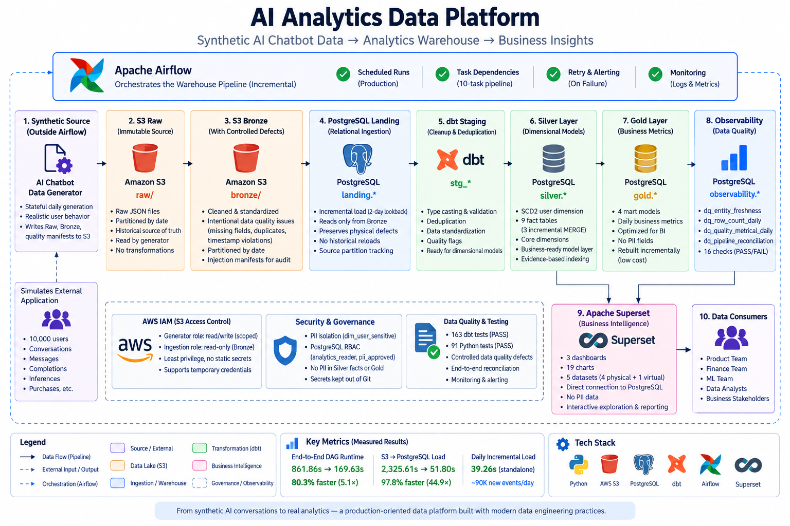

# AI Analytics Data Platform

A Databricks-native batch analytics platform for a simulated AI chatbot product. The current V2 system generates deterministic daily activity inside Databricks, preserves controlled data-quality defects in append-only Delta Bronze tables, builds tested dimensional and business marts with dbt, and serves governed metrics through Databricks AI/BI.

This is a portfolio-scale production design: the data is synthetic, but the ingestion boundaries, incremental processing, SCD2 history, observability, orchestration, deployment, and access controls are implemented and validated end to end.

## Portfolio Highlights

| Capability | What this project demonstrates |
|---|---|
| Data platform | Deterministic synthetic generation into append-only Delta Bronze, followed by dbt staging, Silver dimensions/facts, Gold marts, and observability models. |
| Data engineering | Retry-safe daily processing, incremental Delta `MERGE`, late-arriving and malformed-record safeguards, user SCD2 history, and reconciliation across layers. |
| Governance | Unity Catalog schema boundaries separate operational state, PII, analytical models, and governed observability data. |
| DataOps agent | A read-only LangGraph workflow combines Lakeflow execution evidence, fixed observability queries, and at most two bounded Genie investigations. |
| Command Center | Daily Health Review, one-click investigation, schema-validated reports, evidence expansion, recommendations, and authenticated invocation recovery. |

The bounded V2.6 cloud acceptance demonstrated the complete operational path: **9 of 9 Lakeflow
tasks passed**, while a separately retrieved health snapshot contained **48 monitoring checks —
44 PASS, 4 WARN, and 0 FAIL**. One composite investigation used **two bounded Genie
investigations** and produced **twelve evidence-linked recommendations**. This is the core DataOps
lesson of the project: successful execution and healthy data are related, but they are not the same
signal.



Portfolio materials:

- [Architecture and investigation contract](docs/dataops-agent-architecture.md)
- [Two-to-three-minute narrated demo script](docs/portfolio-demo-script.md)
- [Extended technical demo outline](docs/portfolio-demo.md)
- [Data Engineer and AI Engineer resume bullets](docs/portfolio-resume-bullets.md)
- [Live screenshot capture checklist](docs/portfolio-screenshot-checklist.md)

## Databricks V2 Architecture

The current platform runs end to end on Databricks using Lakeflow Jobs,
serverless compute, Delta Lake, dbt-databricks, Unity Catalog, and AI/BI.

[](images/AI%20Analytics%20Data%20Platform%20Architecture.svg)

The same architecture is maintained as an editable
[Mermaid workflow source](images/AI%20Analytics%20Data%20Platform%20Architecture.mmd).


### Platform responsibilities

- **Serverless Jobs compute** runs the Python/Spark generator and managed Delta writes.
- **Serverless SQL Warehouse** executes dbt-generated SQL and supports AI/BI queries.
- **Delta Lake** provides the managed table format for Bronze, Silver, Gold, and observability data.
- **Unity Catalog** provides the catalog, schema, and table security boundary.
- **Databricks Asset Bundles** define the deployable Lakeflow resource in source control.
- **Databricks AI/BI** presents governed Gold and observability datasets.

## Unity Catalog Layout

```text
ai_analytics
├── source
│   └── clean generator operational state (generator_* tables)
├── bronze
│   └── append-only managed Delta ingestion tables
├── staging
│   └── dbt views over Bronze
├── pii
│   ├── current_user_state
│   ├── user_state_history
│   └── dim_user_sensitive
├── snapshots
│   └── dim_user_snapshot
├── silver
│   ├── safe analytical dimensions
│   └── fact tables
├── gold
│   ├── gold_product_metrics_daily
│   ├── gold_user_activity_daily
│   ├── gold_ml_metrics_daily
│   └── gold_finance_metrics_daily
└── observability
    ├── dq_entity_freshness
    ├── dq_row_count_daily
    ├── dq_quality_metrics_daily
    └── dq_pipeline_reconciliation
```

`source`, `bronze`, `staging`, `snapshots`, and `pii` are restricted internal schemas. `silver`, `gold`, and `observability` are the analytics-facing schemas. Direct identifiers are not exposed through the general Silver user dimension.

## Scheduled Daily Workflow

The deployed Lakeflow Job runs daily at **2:00 AM America/Los_Angeles** with a single concurrent run. Its dependency is explicit:

```text
run_daily_generator
        |
        | run_if = ALL_SUCCESS
        v
run_dbt_warehouse
```

`run_daily_generator` advances the synthetic system by one logical day on serverless Jobs compute. `run_dbt_warehouse` uses a native Databricks dbt task and a serverless SQL Warehouse. It runs these stages in order:

1. Build all staging views.
2. Build `current_user_state`, `user_state_history`, and reference dimensions.
3. Run `dim_user_snapshot`.
4. Build the remaining dimensions.
5. Build all Silver facts.
6. Build Gold marts.
7. Build observability tables.
8. Run the dbt test suite.

If generation fails, dbt does not run. If generation succeeds but transformation or testing fails, the overall job fails on the dbt task. The generator is retry-safe for an already completed logical day, allowing dbt to be retried without advancing source time twice.

## Source and Bronze Design

The synthetic generator runs inside Databricks. Clean operational state is stored separately in `ai_analytics.source.generator_*` tables so the next day can continue users, conversations, subscriptions, and reference data deterministically.

Controlled defects are injected only into Bronze. The managed Bronze tables are append-only and intentionally retain raw-ish physical records with:

- missing fields;
- replay duplicates;
- timestamp-order violations.

Clean generator state is never reconstructed from dirty Bronze. That separation prevents injected test defects from corrupting future source generation and makes retry behavior deterministic.

The V1 S3 Raw and S3 Bronze layers were the one-time historical migration source for the initial Delta tables. They remain useful lineage and migration context, but S3 is not an intermediate hop in the steady-state V2 daily path.

## Staging

`dbt-databricks` reads the managed Delta Bronze tables directly. Staging models are views that:

- select source columns explicitly and normalize types;
- remove deterministic replay duplicates;
- preserve the Bronze `dt` partition as physical lineage;
- retain quality flags for known source defects;
- perform exact recovery only when a reliable relationship supports it.

For the validated August 23 batch, Bronze contained 31,318 physical message rows and staging produced 31,256 logical messages, removing 62 intentional replay rows.

## Silver and User SCD2

The user model applies explicit attribute semantics:

| Change type | Attributes | Behavior |
|---|---|---|
| Type 0 | `signup_at`, `signup_source` | Original signup values remain fixed. |
| Type 1 | `email`, `name` | Latest values overwrite prior values. |
| Type 2 | `country_code`, `account_status` | Historical versions retain effective intervals. |

The model chain separates current state, historical reconstruction, ongoing change tracking, and PII:

- `current_user_state` resolves the current value of each user attribute.
- `user_state_history` reconstructs the historical Type 2 bootstrap from CDC-style updates.
- `dim_user_snapshot` provides ongoing dbt SCD2 tracking.
- `dim_user` combines bootstrap and snapshot history into the safe analytics dimension.
- `dim_user_sensitive` overlays current email and name by `user_key`.

The PII-bearing intermediate models and sensitive dimension live in `ai_analytics.pii`. `dim_user_snapshot` remains in the restricted `snapshots` schema. This keeps direct identifiers and internal change-state models outside the schemas exposed to normal analytics readers.

### Silver facts

The analytical layer contains nine facts:

- `fact_conversation`
- `fact_message`
- `fact_completion`
- `fact_model_inference`
- `fact_feedback`
- `fact_error`
- `fact_subscription`
- `fact_purchase`
- `fact_payment`

The three highest-volume facts—`fact_message`, `fact_completion`, and `fact_model_inference`—use incremental Delta `MERGE` keyed by their business IDs. Their two-day safeguard includes records when either condition is true:

```text
business-event timestamp is inside the lookback
OR
physical Bronze partition is inside the lookback
```

The physical-partition condition retains late arrivals and controlled timestamp-defect rows that could fall outside an event-time-only filter. Smaller facts use deterministic full rebuilds where the simpler strategy remains appropriate.

## Gold Analytics Contract

Gold provides stable, dashboard-ready business grains:

- `gold_product_metrics_daily` — daily product usage and engagement;
- `gold_user_activity_daily` — user/day activity;
- `gold_ml_metrics_daily` — daily model performance;
- `gold_finance_metrics_daily` — daily purchasing and payment outcomes.

Dashboards consume Gold rather than reconstructing core business rules from Bronze or Silver. This keeps metric definitions centralized, tested, and reusable.

## Observability as Data

Operational state is modeled into queryable tables:

- `dq_entity_freshness` measures delay relative to the latest synthetic project activity, not wall-clock time.
- `dq_row_count_daily` detects volume shifts against a rolling seven-day baseline.
- `dq_quality_metrics_daily` monitors known defect and recovery rates.
- `dq_pipeline_reconciliation` validates staging-to-Silver and Silver-to-Gold transitions.

The current validated result is **16 reconciliation checks in PASS and 0 in FAIL**. A `WARN` is an anomaly or monitoring signal; it is not a pipeline failure. A `FAIL` means an actual reconciliation or validity rule failed.

## DataOps AI Command Center

The read-only DataOps AI Agent turns Lakeflow execution evidence and governed observability data into
an operational workflow:

- **Daily Health Review** reports the latest pipeline execution and monitoring snapshot without an
  LLM or Genie call.
- **One-click investigation** runs a deterministic LangGraph workflow that collects Jobs and
  observability evidence, asks at most two bounded Genie questions when supported anomalies exist,
  and returns a validated report with evidence-linked recommendations.
- **Agent Bricks** hosts the Command Center and supplies managed Runtime and Session Stores for
  invocation recovery and conversation history.

The final V2.6 cloud acceptance used release
`07377686d31d6d98b84c428c698d1abdc853f363`. The latest Lakeflow execution passed **9 of 9 tasks**,
while its separately retrieved monitoring snapshot contained **48 checks: 44 PASS, 4 WARN, and
0 FAIL**. The composite investigation completed with **two Genie investigations** and **twelve
evidence-linked recommendations**. This distinction is intentional: successful pipeline execution
does not mean every data-health check passed.

The agent has no job-control, arbitrary-SQL, repair, email, or production-write tool. Proposed
corrections remain advisory and explicitly identify when human approval would be required.

See the [DataOps agent architecture](docs/dataops-agent-architecture.md) and
[portfolio demo outline](docs/portfolio-demo.md).

## Databricks AI/BI

The Databricks AI/BI dashboard has four pages:

- **Product Overview**
- **AI / Model Performance**
- **Finance**
- **Pipeline Health**

Dashboard datasets consume Gold and observability tables, with latest-date datasets used where a current operational view is appropriate. Genie Code assisted with authoring dashboard visualizations, and dashboard users analyze data through Unity Catalog governance.

The dashboard currently lives in the Databricks workspace; it is not declared as an Asset Bundle resource in this repository.

## Security and Governance

PII means personally identifiable information. The dedicated `pii` schema makes direct identifiers a separate Unity Catalog security boundary.

The versioned policy in [`databricks/governance/grants.sql`](databricks/governance/grants.sql) defines two principals:

- **`analytics_reader`** receives `USE CATALOG` on `ai_analytics` plus `USE SCHEMA` and `SELECT` on `silver`, `gold`, and `observability`. It receives no access to `pii`, `source`, `bronze`, `staging`, or `snapshots`.
- **`pii_approved`** receives the normal analytics access plus `USE SCHEMA` and `SELECT` on `pii`.

Unity Catalog governs data access; the Asset Bundle deploys workflow configuration. Those are separate responsibilities.

## Production Validation

The latest scheduled end-to-end run was validated across the warehouse:

```text
Bronze latest logical date
  = Staging latest logical date
  = Silver latest logical date
  = Gold latest logical date
```

The final reconciliation query returned zero rows:

```sql
select *
from ai_analytics.observability.dq_pipeline_reconciliation
where status != 'PASS';
```

This proves that the scheduled generator, managed Bronze writes, dbt transformations, SCD2 processing, facts, Gold marts, observability, and tests advanced together for the validated production run. The generator baseline contains 10,000 synthetic users; event and historical table sizes grow as scheduled logical days are added.

## Architecture Evolution: V1 to V2

V1 remains valuable engineering history. It established deterministic generation, controlled defects, medallion boundaries, hybrid SCD2 modeling, observability, and incremental processing before those concepts were migrated to a Databricks-native implementation.

| Capability | V1 | V2 |
|---|---|---|
| Orchestration | Apache Airflow | Databricks Lakeflow Jobs |
| Ingestion | S3 Bronze to PostgreSQL Landing | Managed Delta Bronze read directly by dbt |
| Warehouse | PostgreSQL | Delta Lake and Databricks SQL |
| dbt adapter | `dbt-postgres` | `dbt-databricks` |
| Compute | Docker/local services | Serverless Databricks compute |
| BI | Apache Superset | Databricks AI/BI |
| Governance | PostgreSQL roles | Unity Catalog RBAC |
| PII boundary | Restricted PostgreSQL table | Dedicated Unity Catalog `pii` schema |
| Deployment | Docker Compose/manual infrastructure | Databricks Asset Bundles |

```text
V1
Synthetic generator -> S3 Raw -> S3 Bronze -> PostgreSQL Landing
-> dbt-postgres Silver -> Gold -> Observability -> Superset
Orchestration: Airflow

V2
Databricks source state -> Managed Delta Bronze -> dbt-databricks Staging
-> Delta Silver -> Delta Gold -> Observability -> Databricks AI/BI
Orchestration: Lakeflow Jobs | Governance: Unity Catalog
```

The original diagram is retained as a record of the V1 architecture:



V2 is not a rejection of V1; it applies the same tested data-engineering principles through a more integrated cloud runtime with managed storage, serverless compute, unified governance, and reproducible resource deployment.

## Technology Stack

### Current V2

- Python and Spark for deterministic source generation and Bronze ingestion
- SQL, dbt, and `dbt-databricks` for transformation, snapshots, and testing
- Databricks Lakeflow Jobs for orchestration
- Databricks Asset Bundles for deployment configuration
- Delta Lake and managed Unity Catalog tables
- Unity Catalog for schema-level RBAC
- Serverless Jobs compute and Serverless SQL Warehouse
- Databricks AI/BI for governed dashboards
- Agent Bricks and LangGraph for the read-only DataOps application
- Databricks Genie for bounded historical observability questions
- AWS as the cloud foundation, with S3 retained as the historical migration source

### Legacy V1 components retained in the repository

- Apache Airflow
- PostgreSQL
- Apache Superset
- Docker Compose
- S3 Raw and Bronze utilities

## Repository Layout

```text
databricks/
├── ingestion/       managed Delta Bronze and generator-state helpers
├── jobs/            Databricks daily generator entry point
├── migration/       one-time V1-to-V2 migration notebooks
├── tests/           Databricks integration-validation notebooks
└── governance/      Unity Catalog grant policy

resources/           Lakeflow Job Asset Bundle resources
databricks.yml       root Databricks Asset Bundle definition

dbt/
├── models/
│   ├── silver/staging/
│   ├── silver/
│   ├── gold/
│   └── observability/
├── snapshots/
└── tests/

src/data_generator/  shared deterministic generator and legacy V1 loaders
src/data_quality/    historical S3 profiling utility
tests/               Python unit and integration-focused tests

dataops-agent/       read-only Agent Bricks + LangGraph DataOps application
docs/                DataOps architecture and portfolio demo walkthrough
airflow/             V1 Airflow DAG and local runtime
superset/            V1 Superset configuration
sql/                 V1 PostgreSQL security SQL
infra/iam/           historical component-scoped S3 policies
```

Generated data, local environment files, credentials, dbt runtime artifacts, databases, caches, and logs are excluded from source control.

## Deploying Databricks V2

Prerequisites are a Databricks CLI profile with access to the target workspace and permissions for the configured Unity Catalog objects and SQL Warehouse. Credentials and tokens must remain outside Git.

Validate the Asset Bundle:

```bash
databricks bundle validate -t dev -p ai-analytics-dev
```

Deploy the version-controlled Lakeflow resource:

```bash
databricks bundle deploy -t dev -p ai-analytics-dev
```

The job is scheduled daily. Do not manually run the production generator as a routine setup step: a successful execution advances the synthetic logical date.

### Legacy V1 / Local PostgreSQL stack

The original local stack remains available for architecture history and local experimentation. It requires Python, Docker Compose, PostgreSQL services, and external AWS configuration for the historical S3 path.

```bash
python -m venv venv
venv/bin/pip install -r requirements.txt
docker compose -f airflow/docker-compose.yaml up -d --build
docker compose -f superset/docker-compose.yaml up -d
```

These commands start the V1 local services; they are not part of the Databricks V2 production path.

## Testing and Validation Coverage

The repository includes Python, dbt, and Databricks notebook validation rather than claiming a fixed test count that will become stale. Coverage includes:

- deterministic generator behavior and isolation from process-global RNG state;
- managed Delta schema alignment, append idempotency, and retry behavior;
- staging row-count, duplicate, defect, and recovery reconciliation;
- SCD2 version counts, interval integrity, current-row coverage, and attribute semantics;
- fact uniqueness, dimensional relationships, and user-time matching;
- incremental Delta `MERGE` behavior for high-volume facts;
- Gold-to-Silver and observability reconciliation;
- daily runner sequencing, replay safety, and state-update invariants.

## Key Engineering Decisions

- Clean generator state is separated from dirty Bronze so controlled defects cannot corrupt future source state.
- Bronze is append-only Delta and preserves physical duplicates and malformed records for downstream validation.
- Defect injection and daily generation are deterministic and retry-safe.
- Adapter-aware macros preserve dbt portability while allowing Databricks-native SQL where required.
- User history combines a CDC-style historical bootstrap with an ongoing dbt snapshot.
- Only the three highest-volume facts use incremental `MERGE`; smaller facts favor deterministic simplicity.
- Incremental facts combine physical-partition and event-time lookbacks to retain late or malformed records.
- PII-bearing models live in a dedicated Unity Catalog schema.
- Unity Catalog RBAC separates analytics access from PII approval.
- Observability is modeled as data rather than hidden only in logs.
- Gold is the stable BI contract; dashboards do not duplicate core transformation logic.
- Serverless compute reduces cluster management for this portfolio workload.
- Asset Bundles make workflow deployment configuration reproducible and reviewable.
