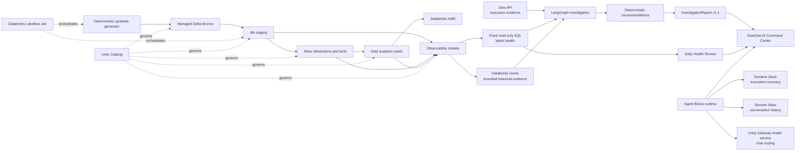

# DataOps AI Agent Architecture

The DataOps AI Agent is a read-only operational plane over the Databricks analytics platform. It
does not sit in the data path and cannot change Lakeflow jobs, tables, permissions, schedules, or
monitoring results.

## Investigation contract

The Daily Health Review is lightweight: opening it or refreshing it calls the Jobs API and fixed
observability queries only. **Run Full Investigation** deterministically invokes the existing
LangGraph composite workflow; an LLM does not decide which tool to call. The graph collects Jobs
and observability evidence in parallel, conditionally asks Genie at most two bounded historical
questions, generates deterministic recommendations, and validates the result as report schema
`1.1`.

Pipeline execution health and monitored data health are separate signals. A successful Lakeflow run
does not turn monitoring `WARN` or `FAIL` results into `PASS`, and the application does not claim
that a monitoring snapshot belongs to a particular run unless authoritative evidence establishes
that association.

## Read-only boundary

- Jobs access is `CAN VIEW`; there is no job-control tool.
- The SQL Warehouse is used by fixed `SELECT` statements only.
- The app can read the four governed observability tables and run the existing Genie Agent.
- Recommendations are advisory. Proposed corrections carry human-approval labels but have no
  execution button or repair implementation.
- Incident alerting and email libraries are inactive and are not registered as agent tools.
